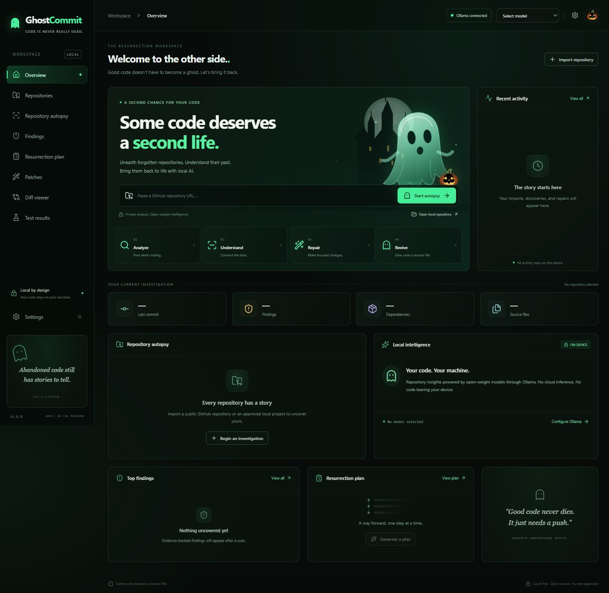

# 👻 GhostCommit

**Some code deserves a second life.**

A repository restoration workspace with local Git storage and selectable local or cloud inference. Import a public GitHub project or an explicitly approved local Git repository, inspect real source evidence, ask your selected model to explain it, and review focused repairs before applying them to a separate working copy.

Forgotten projects are often hard to understand before they are hard to fix. GhostCommit makes that first investigation visible, grounded and incremental. Inactivity is context, never proof of abandonment.

## Run locally

For hosting, use the included **Render Blueprint**: see [deployment and Git push steps](docs/DEPLOYMENT.md). It deploys the frontend and API together with a paid persistent disk and public access without a login. The current SQLite/Git backend requires a persistent server; Vercel-only hosting needs an architectural change.

Requires **Node.js 22.14+**, npm and Git. AI features use either a server-side Google API key or [Ollama](https://ollama.com/). SQLite is provided by Node (experimental on Node 22).

```sh
npm ci
npm run dev
```

Open **http://127.0.0.1:5173**. Vite proxies `/api` to Express on loopback port 3001. Keep the backend bound to loopback; this application is not a multi-user hosted service.

For a production build, served by Express:

```sh
npm run build
npm start
```

Open **http://127.0.0.1:3001**.

### Google API (Gemini or available hosted Gemma models)

Google API is the default provider. Set the key in the project-root **`.env`** file:

```dotenv
GEMINI_API_KEY=your_key_here
```

Use `.env.example` as the template if `.env` does not exist. Key changes in `.env` are detected on the next provider refresh or request; a restart is not required. An explicit process-environment key takes precedence over the file. Never use a `VITE_` prefix. The key stays in the server process, is sent to Google in a request header, and is never returned through the settings API or frontend bundle.

Open Settings → AI provider, refresh models, choose an available model, enable **I allow cloud AI analysis**, and save. Model names are obtained from Google’s API; actual hosted Gemma models can be selected when the key has access. Gemini inference is always labelled with its real model/provider. No local model loading or GPU memory is needed for this provider.

**Cloud privacy:** analysis, plan generation and patch generation send bounded repository evidence and relevant source snippets to Google. Source storage and Git operations remain local. Google’s usage terms, quotas and billing apply. There is no silent cloud fallback from Ollama. Cloud inference requires network access and explicit consent in Settings. Both Gemini structured JSON and hosted Gemma prompt-based JSON are validated against the same Zod schemas and evidence checks.

The autopsy card includes setup diagnostics, an animated working state, elapsed time, real stream activity, cancellation, in-place errors and a start/retry action. Missing configuration is rejected before a background generation starts. Local session tokens renew once after backend restarts, without retrying already accepted jobs.

See the [Google API reference](https://ai.google.dev/api/generate-content) and [model discovery documentation](https://ai.google.dev/api/models). Real analysis of the imported CityAd repository was verified using `gemini-2.5-flash`; the hosted Gemma request returned a provider HTTP 500. Fixture contract tests cover the remaining boundaries.

### Ollama (optional local provider)

Select Ollama as the provider in Settings. Start Ollama, install an appropriate coding-capable model using `ollama pull <model-name>`, and select it in Settings. GhostCommit discovers models from `/api/tags`; no model name is hardcoded and no model is downloaded automatically. Model quality, structured-output support and memory consumption vary. Start with a small quantized model and a 4K context window on a 16 GB laptop.

The endpoint defaults to `http://127.0.0.1:11434`. Only HTTP loopback endpoints are accepted. Requests stream through the backend, support cancellation, have timeouts and output limits, validate against Zod schemas, and retry malformed output once. One inference job runs at a time. Enable **CPU inference** in Settings if GPU memory is limited; this uses system RAM and can be slower. Exact Ollama service errors are surfaced instead of replaced with mock results.

### Approve local directories

The browser never sends arbitrary filesystem paths. Stop the dev backend and start it with explicit approved roots:

```sh
npm start -- --allow-local="D:/my/projects"
```

Run `npx vite --host 127.0.0.1` in another terminal for frontend development, or use the built frontend on port 3001. The picker lists the approved directory itself and its immediate child Git repositories. Multiple `--allow-local=` arguments are accepted. Alternatively set `GHOSTCOMMIT_LOCAL_ROOTS`, separated by your platform’s path delimiter (`;` on Windows, `:` on Unix).

Local imports copy **committed history only** using Git. Uncommitted source changes are not included. No hooks, submodules, dependency installation or project scripts are run. The original checkout stays untouched.

## Workflow

1. Paste `https://github.com/owner/repository`, or choose an approved local Git repository.
2. Follow the actual import and scan stages. Explore eligible source files in the read-only Monaco workspace.
3. Review deterministic findings and their evidence. Dependency freshness is explicitly **unverified** without registry evidence.
4. Select a model and provider. For Google, enable cloud consent; then run **Analyze with Google AI**. For Ollama, run **Analyze with local AI**.
5. Generate a resurrection plan, select one task and prepare a focused patch for an existing file.
6. Review the Monaco diff. **Approve** the proposal, then **Apply to separate copy**. Rejection and export are available independently.
7. Export the JSON autopsy report and unified diff. Test status remains **not run** unless a future isolated runner actually executes tests.

No fake repositories, metrics, AI results or activity records are seeded into production views.

## Interface



Original SVG moon, castle, ghost and pumpkin artwork; near-black glass panels, restrained emerald accents, responsive navigation and reduced-motion support. No external images, web fonts or editor CDN are required at runtime. Inter is used when installed, with system UI fallback; code uses a local monospace font.

## Architecture

```text
React + TypeScript + Vite
  React Router · TanStack Query · Zustand
  Tailwind CSS · shadcn-style Button · Framer Motion · Lucide · Monaco
        │ same-origin REST + server-sent events
Express + Zod (local loopback or public hosting, mutation session tokens)
        ├── Git CLI → bounded isolated imported checkout
        ├── file filtering → Tree-sitter WASM → deterministic findings
        ├── bounded evidence context → selected AI provider → schema validation
        │                            ├── local Ollama
        │                            └── Google API (explicit cloud consent)
        └── SQLite metadata, activities, approvals, plans, tests, patches
                              │
                       explicit patch approval
                              ↓
                 separate source working copy + Git snapshot
```

Code lives in `src/`, `server/`, `shared/`, `tests/` and `scripts/`. Runtime data defaults to `.ghostcommit/`; override it with `GHOSTCOMMIT_DATA`. Repository source is stored in separate directories, not database blobs. Patch proposals necessarily retain original and proposed target-file content for review. SQLite stores JSON records with parameterized queries and WAL journaling.

Important API routes:

| Purpose | Routes |
| --- | --- |
| Connectivity | `GET /api/health`, `/api/ai/status`, `/api/ai/status?provider=gemini`, `/api/ollama/status`, `/api/ollama/models` |
| Import | `POST /api/repositories/import`, `GET /api/local-repositories` |
| Sources | `GET /api/repositories/:id`, `/tree`, `/files?path=...` |
| Analysis | `POST /api/repositories/:id/scan`, `/analyze`; `GET .../analysis`, `.../findings` |
| Planning | `GET/POST /api/repositories/:id/plan` |
| Patches | `POST /api/patches/generate`; `GET /api/patches/:id`, `.../diff`; `POST .../approve`, `.../reject`, `.../apply` |
| Reporting | `GET /api/repositories/:id/report`, `GET/POST .../tests` |
| Control | `GET /api/events`, `POST /api/repositories/:id/cancel`, `GET/PUT /api/settings` |
| Local deletion | `DELETE /api/repositories/:id` |

Mutation clients first request `GET /api/session`, then send the returned token in `X-GhostCommit-Token`. Requests validate Host, Origin and Fetch Metadata; CORS is not enabled. These defenses reduce browser cross-site access, but do not authenticate against malicious local processes or browser extensions.

## Security and limits

- Imports allow normalized public GitHub HTTPS URLs only, or server-approved local candidates. Git uses argument arrays, disabled global/system configuration, hooks, credential helpers, fsmonitor and external protocols. Remote clones fetch at most 200 commits; the displayed commit count may be partial.
- Imports have a 120-second clone timeout, monitored disk limits and expanded Git tree size checks before checkout. Defaults: 100 MB per repository, 256 KB per file, 20,000 tracked files. Partial failed imports remain visible and can be deleted from Repositories.
- Tracked files only; generated directories, `.gitignore` matches, Git internals, secret-like files, binary content and symbolic links are excluded. Component-wise realpath checks prevent symlink escapes. Credential detection is heuristic; it is not a full secret scanner.
- Tree-sitter parses JavaScript, TypeScript/TSX, Python and Java. Rules are limited and are not a comprehensive security audit. Syntax errors may reflect grammar limitations.
- Dependency counts support `package.json` and ordinary `requirements.txt` entries. `pyproject.toml`, Maven and Gradle manifests are flagged for manual review; advanced requirements syntax needs manual review too. No dependency registry or vulnerability database is consulted.
- AI receives bounded snippets, a truncated tree and scanner evidence. Source content is treated as untrusted data. AI findings must quote supplied snippets and match an actual file and line; suggestions remain unverified even when their evidence exists. Overview text and recommendations still require human review.
- Patches can alter one eligible existing text file. Original content must match exactly; secret-like output and no-op changes are rejected. Approval applies to that immutable proposal. Applying creates a new filtered source snapshot and Git repository, preserving the original import. Each patch gets an independent working copy; multiple patches are not composed automatically. File permissions and full original history are not copied into patch workspaces.
- **No isolated runner is implemented. Test execution is disabled.** No imported code, dependency lifecycle scripts or test commands are run on the host. Export a patch for verification in an environment you independently trust.
- Local inference protects privacy; safe file handling limits access; secure execution requires an additional isolation boundary. None is a claim of complete security.
- Model requests are context-limited and serialized. Cancellation interrupts active clone/inference and scanner stages; a short in-flight Git metadata command may finish before cancellation is observed.
- Activity retention is applied at startup. Imported source, proposals and approvals remain until explicitly deleted. Use Repositories → delete to remove an imported project and its working copies.

## Verification

```sh
npm run build
npm test
npm run test:live
```

The default suite tests real Git/SQLite/source parsing, traversal and symlink handling, cross-site/token checks, model-output contracts, evidence rejection, plan and patch lifecycle, explicit approval, separate-copy application, export and truthful test status. Its model HTTP server is an **explicit test fixture**; production never substitutes fixture responses.

`test:live` additionally uses an actually installed Ollama model, selects the smallest available model unless `GHOSTCOMMIT_TEST_MODEL` is set, and runs import → real analysis → plan → real patch → approval → working copy on a deliberately legacy development fixture. Reports stay in ignored `test-artifacts/`. It can fail honestly when the model does not follow the schema or file scope. No imported project scripts are executed.

After initial dependency/model setup and import, source exploration, static analysis, review and report export work offline. AI analysis, plans and patch generation work offline **only with the Ollama provider and an installed model**. Google API inference and new GitHub imports require network access. Monaco and its workers are bundled locally.

## Contributing and roadmap

Keep repairs minimal, preserve evidence references, and add boundary tests for new file operations. Run the build and tests before proposing a change. Do not remove approval gates or enable host-side repository execution. Report security issues privately to the repository maintainer before publishing exploit details.

Next: audited disposable test runners, richer language-specific analysis, complete TOML/XML dependency parsers, optional verified registry checks, patch composition and optional GitHub PR integration. Creating a PR is not implemented in this release.

## Licensing

Original application code and SVG illustrations are [MIT licensed](LICENSE). Dependency licenses and bundled notices remain their authors’ property; see [third-party notices](THIRD_PARTY_NOTICES.md). Open-source software and open-weight models are different: model weights may have separate use, redistribution and attribution requirements. Review the license of each selected model; GhostCommit does not redistribute weights.
